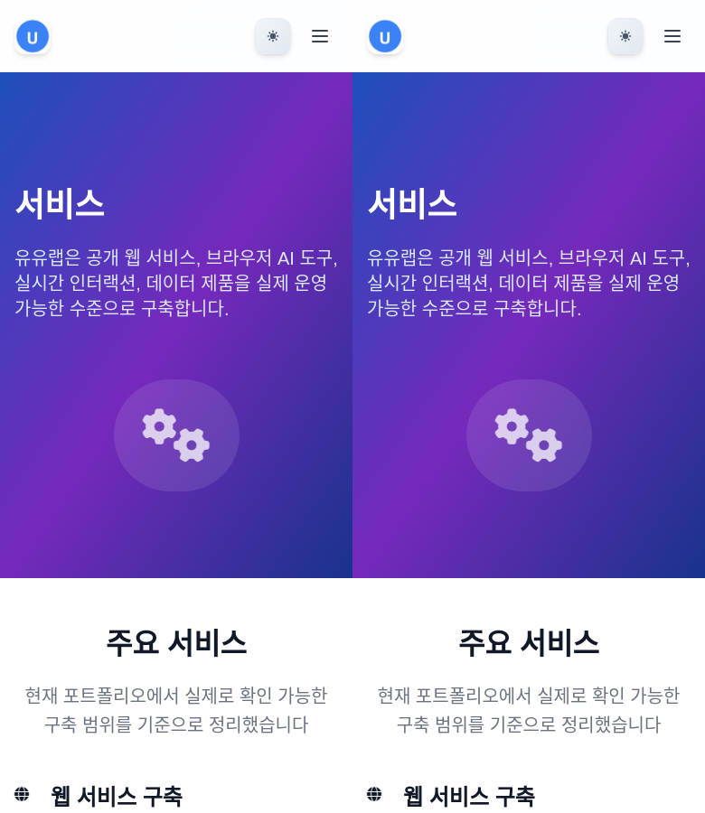

# Website Cloner

**URL을 관찰하고, 편집 가능한 프런트엔드로 재구현하고, 화면과 동작을 확인하는 에이전트 스킬.**

Codex · Claude Code · Agent Skills 호환 에이전트에서 사용합니다. 원본 관찰부터 반응형 구현, 자산 출처, 화면 비교, 미검증 항목까지 프로젝트 안에 기록합니다.

[스킬](skills/website-clone/SKILL.md) · [실제 클론 사례](docs/case-studies/uulab-services/report.md) · [새 실사이트 검증](docs/case-studies/uulab-services/suite-integration-2026-11-01.md) · [일괄 검증](docs/verification-suites.md) · [검증 기준](skills/website-clone/references/verification.md) · [기여 방법](CONTRIBUTING.md) · [라이선스·출처](THIRD_PARTY_NOTICES.md)

## 구성

| 구성 | 하는 일 |
| --- | --- |
| `website-clone` 스킬 | 범위 설정 → 증거 수집 → 관찰 → 구현 → 비교·수정 |
| Capture CLI | 동일한 화면 크기의 PNG, 렌더링 정보, 자산 목록, 오류 기록 수집 |
| Compare CLI | 같은 크기의 PNG 비교, 차이 이미지와 나란히 보기 생성 |
| Verify CLI | 원본·구현을 같은 환경에서 캡처하고 비교 보고서 생성 |
| Verify Suite CLI | 여러 경로·화면 크기·동작 상태를 일괄 실행하고 통합 보고서 생성 |
| 실제 예제 | 유유랩 서비스 페이지의 독립적인 프런트엔드 재구현 |
| 테스트·CI | CLI 입력/파일 보호/PNG 비교/브라우저 캡처와 예제 동작 검증 |

스킬만 설치해도 사용할 수 있습니다. 캡처·비교 CLI는 선택 도구입니다. 구현을 수행할 코딩 에이전트와 브라우저 접근이 필요하며, CLI 자체가 완성 앱을 자동 생성하거나 서버·인증·결제를 복원하지는 않습니다. 유료 스크래핑 API나 별도 운영 서버는 필수가 아닙니다.

## 1. 스킬 설치

[Skills CLI](https://github.com/vercel-labs/skills)를 사용하는 경우, **스킬을 사용할 프로젝트 폴더**에서 실행합니다. Skills CLI는 Node.js 22.20+를 요구합니다.

```bash
npx skills add https://github.com/uulab-official/website-cloner --skill website-clone
```

설치할 에이전트를 선택합니다. Codex만 선택하려면 `-a codex`, Claude Code만 선택하려면 `-a claude-code`를 추가합니다. `-g`는 모든 프로젝트에서 쓸 전역 설치입니다.

직접 설치할 때는 `skills/website-clone/` **전체 폴더**를 에이전트의 스킬 디렉터리로 복사합니다. Codex 프로젝트는 `.agents/skills/website-clone/`, Claude Code 프로젝트는 `.claude/skills/website-clone/`를 사용할 수 있습니다. `SKILL.md`만 복사하면 참고 문서와 라이선스가 빠집니다.

이 저장소를 프로젝트로 연 Claude Code에서는 `.claude/commands/website-clone.md` 연결 파일도 사용할 수 있습니다. 기존 프로젝트에 이 저장소의 `AGENTS.md`를 덮어쓸 필요는 없습니다.

### 요청 예시

```text
website-clone 스킬을 사용해 https://내사이트.example/services/ 를 재구현해줘.
현재 React + Vite 구조를 유지하고, 데스크톱과 모바일 메뉴·FAQ까지 확인해줘.
원본과 구현의 캡처, 자산 목록, 검사 결과와 남은 차이를 docs/clone에 기록해줘.
```

브랜드 변경을 원할 때는 “구성은 참고하고 유유랩 브랜드로 바꿔줘”라고 명시합니다. 그대로 재현하는 작업에서는 스킬이 임의로 다른 디자인으로 바꾸지 않습니다.

## 2. 실제 예제 실행

도구와 예제는 Node.js 22.12+에서 실행합니다.

```bash
git clone https://github.com/uulab-official/website-cloner.git
cd website-cloner
npm ci
npm run dev
```

Vite가 출력한 주소에서 `/services/`를 엽니다. `/`도 같은 예제의 진입점입니다. 예제는 원본의 아홉 개 본문 섹션, 모바일 내비게이션, 테마 전환, FAQ와 프로젝트 이미지를 포함합니다. 범위 밖의 링크는 원래 유유랩 사이트로 연결합니다.

```bash
npm run build
npm run preview
```

정적 빌드 결과는 `dist/demo/`입니다. 별도 서버 로직 없이 제공할 수 있습니다. 원본 전체 사이트나 문의 처리 시스템을 복원한 예제는 아닙니다.

## 3. 캡처와 비교

먼저 브라우저를 준비합니다.

```bash
npx playwright install chromium
```

Linux CI에서는 필요한 시스템 라이브러리를 함께 설치하는 `npx playwright install --with-deps chromium`을 사용할 수 있습니다. 한글 페이지를 비교할 Linux 환경에는 Noto CJK처럼 한글을 지원하는 시스템 폰트가 필요합니다. 두 화면은 같은 브라우저·폰트 환경에서 캡처합니다.

### 화면 캡처

```bash
npm run capture -- --url https://내사이트.example/ --out artifacts/source --widths 1440,390 --height 900
npm run capture -- --url http://localhost:5173/ --out artifacts/local --widths 1440,390 --height 900
```

각 실행은 새로운 브라우저 컨텍스트를 사용합니다. `capture.json`과 각 `WIDTHxHEIGHT/`의 `page.json`, `viewport.png`, `full-page.png`를 만듭니다. JSON에는 실제 화면 크기, 브라우저 버전, 최종 URL, 글꼴, 주요 요소의 치수, 이미지, 콘솔 오류, 실패 요청과 가로 넘침이 포함됩니다.

메뉴나 FAQ를 연 상태는 로컬 JSON 파일로 지정합니다.

```json
[
  { "type": "click", "selector": "details:first-of-type summary" },
  { "type": "scroll", "selector": "details:first-of-type" }
]
```

```bash
npm run capture -- --url http://localhost:5173/services/ --out artifacts/faq --widths 390 --height 900 --state faq-open --actions actions.json --keep-scroll
```

`--keep-scroll`은 실행한 동작 이후의 스크롤 위치를 유지합니다. 지정하지 않으면 맨 위로 돌아와 캡처합니다. 원본 사이트에서는 메뉴·탭·FAQ처럼 요청 범위의 관찰 동작만 지정하며, 실제 문의·구매 등의 제출은 자동 검증에 포함하지 않습니다.

`--scheme light|dark`는 브라우저의 선호 색 모드입니다. 자체 테마 버튼을 쓰는 사이트는 관찰한 버튼을 actions에 지정합니다. 고정 캡처에서는 reduced motion과 애니메이션 정규화를 사용하며 메타데이터에 남깁니다. **이 캡처만으로 모션이나 터치 기기 동작을 검증했다고 판정하지 않습니다.**

### 같은 크기의 PNG 비교

```bash
npm run compare -- --source artifacts/source/1440x900/viewport.png --target artifacts/local/1440x900/viewport.png --out artifacts/comparison-desktop
```

출력은 `diff.png`, `side-by-side.png`, `report.json`입니다. 크기가 다르면 실패 기록을 남기고 종료합니다. 원본을 임의로 늘이거나 줄이지 않습니다. 전체 페이지 높이가 다르면 레이아웃 차이를 먼저 조사하거나 동일한 뷰포트 캡처를 비교합니다.

변경 픽셀 비율은 오차를 찾기 위한 지표입니다. **“완성도 98%” 같은 의미 점수가 아닙니다.** 글꼴·동적 데이터·애니메이션에 영향을 받으며 버튼 동작을 증명하지도 않습니다. 필요한 경우에만 `--max-diff-ratio 0.02`처럼 프로젝트가 정한 기준으로 실패 여부를 지정합니다. 기본값에는 자동 합격 기준이 없습니다.

기존 실행 결과를 바꾸려면 `--overwrite`가 필요합니다. 도구가 만든 실행 디렉터리만 교체할 수 있고, 일반 폴더와 입력 파일을 포함한 경로는 보호합니다. 모든 옵션은 `npm run capture -- --help`와 `npm run compare -- --help`에서 확인할 수 있습니다.

### 원본·구현 짝 검증과 여러 상태 일괄 실행

원본과 구현을 한 번에 캡처·비교할 때는 `verify`를 사용합니다.

```bash
npm run verify -- --source https://uulab.co.kr/services/ --target http://127.0.0.1:4173/services/ --out artifacts/paired
```

여러 경로·화면 크기·메뉴·테마 상태는 JSON 설정 하나로 실행합니다. 아래 예제는 먼저 production build의 preview를 `4173` 포트에서 실행한 상태에서 사용합니다.

```bash
npm run verify:suite -- --manifest suites/uulab-services.json --dry-run
npm run verify:suite -- --manifest suites/uulab-services.json --out artifacts/services-suite
```

예제는 **4개 사례·7개 화면 조건**입니다. `artifacts/services-suite/index.html`에서 사례별 원본/구현/차이 이미지로 이동합니다. 동작 파일은 설정 파일 위치 기준으로 읽고, 모든 입력을 검사한 뒤 실행합니다. 기본적으로 한 사례가 실패해도 나머지는 실행하며 `--fail-fast`로 중단할 수 있습니다. 임계값을 지정하지 않은 결과를 시각적 합격으로 표시하지 않습니다. 경로 매핑과 전체 옵션은 [일괄 검증 사용법](docs/verification-suites.md)을 참고하세요.

## 4. 검증

```bash
npm test
npm run check
```

`npm test`는 CLI·PNG·스위트 검사를 실행합니다. 브라우저를 설치한 뒤 실행하는 `npm run check`는 스킬 패키지 검사, **실제 브라우저 캡처 테스트**, 예제 production build, 예제의 테마·메뉴·FAQ·반응형·자산 검사를 모두 실행합니다. 테스트는 로컬 fixture와 빌드된 예제를 사용하므로 운영 사이트 상태에 의존하지 않습니다.

이미 설치된 다른 Chromium을 명시해야 한다면 캡처에 `--executable-path`를 지정할 수 있습니다. 전체 검사에서는 `CLONER_CHROMIUM_PATH` 환경변수로 지정합니다. 사용한 버전은 증거에 기록합니다. TLS 오류가 나면 인증서 검증을 끄지 말고 오류를 기록한 뒤 승인된 브라우저나 명시적으로 구분한 정적 참조 자료를 사용합니다.

## 실제 클론 시도와 한계

[초기 UULab 서비스 사례 보고서](docs/case-studies/uulab-services/report.md)는 원본 관찰, 경로 범위, 자산 출처와 정적 참조본 비교를 기록합니다. 아래 이미지는 그 초기 실행이며 **왼쪽은 정적 참조본, 오른쪽은 구현**입니다. 이를 최신 실사이트 캡처로 표시하지 않습니다.



**2026-11-01 후속 검증에서는 운영 중인 HTTPS 원본을 새로 캡처했습니다.** [실사이트 스위트 통합 결과](docs/case-studies/uulab-services/suite-integration-2026-11-01.md)에 전체 검사 **178개 통과**, 4개 사례·7개 화면 조건, 다크 상태 및 경로 매핑, 실제 비율과 남은 차이를 기록했습니다. 기존 이미지를 재집계한 결과가 아닙니다. 이번 통합은 도구/테스트/문서 변경이며 예제 화면 자체를 개선한 변경은 아닙니다.

모바일 첫 화면은 변경 픽셀 0%였지만 전체 페이지 높이는 8px 다르고 메뉴의 배경·높이·아이콘 차이도 남았습니다. 픽셀 수치는 화면 한 장의 차이일 뿐, 전체 사이트나 모든 기능의 복제를 증명하지 않습니다. Safari·실제 휴대폰·백엔드·모션·원본의 모든 상호작용은 이 실행에서 검증하지 않았습니다. 일반 CI는 로컬 fixture로 유지하며 실사이트 스위트는 별도 opt-in 워크플로로 실행합니다.

## 프로젝트 구조

```text
skills/website-clone/          독립 설치 가능한 스킬과 참고 문서
scripts/                      캡처·PNG 비교·짝 검증·일괄 검증
suites/                       경로·화면·상태 검증 설정
examples/uulab-services/       편집 가능한 실제 재구현 예제
tests/                        도구 검사와 예제 브라우저 검사
docs/case-studies/             실행 증거·자산 출처·제한 사항
.github/workflows/ci.yml       로컬 fixture 기반 자동 검증
.github/workflows/verification-suite.yml  명시적 실사이트 스위트 실행
```

## English overview

Website Cloner is a portable agent skill with optional local evidence tools. An agent observes a source, rebuilds editable frontend code in the existing stack, and records matched screenshots, interaction checks, and remaining gaps. Install the standalone `website-clone` skill with the Skills CLI, or run the repository's capture/compare/verify commands and isolated UULab example. `verify:suite` runs explicit routes and states from a strict JSON manifest and links the resulting reports. No paid scraping service is required. The toolkit does not recover private backend logic, and a build or pixel ratio is not a claim of complete fidelity.

## Credits

Inspired by and adapted from [JCodesMore/ai-website-cloner-template](https://github.com/JCodesMore/ai-website-cloner-template). Original MIT copyright and terms are preserved in the skill. New toolkit code is MIT; third-party fonts and case-study assets retain their own notices. See [THIRD_PARTY_NOTICES.md](THIRD_PARTY_NOTICES.md).
