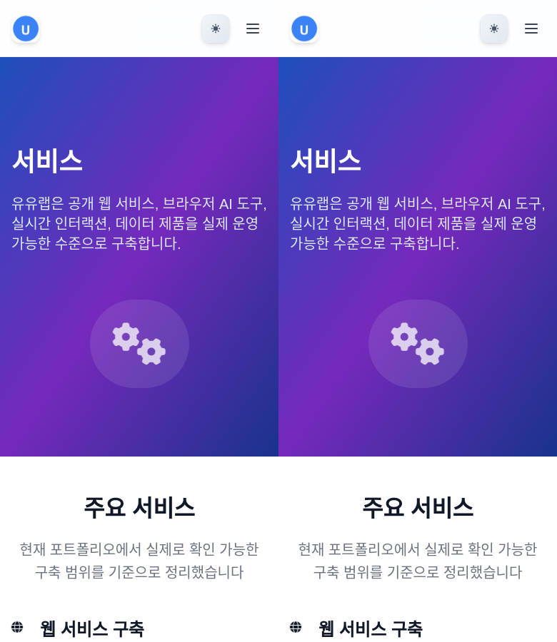

# Case study: UULab services

The first real trial rebuilt [UULab's services page](https://uulab.co.kr/services/) as editable HTML, CSS, and JavaScript. The nine main sections, local images, theme controls, mobile navigation, FAQ disclosures, and back-to-top control are implemented. This report separates **live observations**, **static-reference comparisons**, and **local behavior tests**.

## Scope

- Source: <https://uulab.co.kr/services/>, observed and captured on **2026-11-01**.
- Mode: faithful frontend reconstruction of one route, with intentional narrow-footer wrapping and open-menu readability improvements.
- Implementation: [`examples/uulab-services/`](../../../examples/uulab-services/), using Vite and semantic HTML/CSS/JavaScript. Content is pre-rendered into both entry pages and remains readable without JavaScript.
- Live source observations used the cloud browser. Desktop light/dark states and the first native FAQ disclosure were exercised.
- Direct headless HTTPS capture of the source failed with a certificate trust error in the executor. Certificate validation was not disabled and the browser trust store was not changed.
- Matched quantitative comparisons therefore use a **static reference snapshot** of the public HTML, observed CSS, and downloaded assets. All source scripts were removed. The observed initial services-navigation selection, zero scroll progress, and hidden back-to-top state were applied. Font Awesome was loaded immediately for deterministic reference rendering.
- The reference page/styles were inspection materials only. They are not shipped as the implementation. The example uses newly authored reusable markup, styles, content data, and behavior; it does not embed a screenshot, iframe, or source production bundle.

See [`evidence/provenance.json`](evidence/provenance.json) for source hashes, reference adjustments, capture conditions, and the distinction between CSS and image dimensions. [`assets.json`](assets.json) records the actual local files, source URLs, dimensions, hashes, and licenses.

## Routes

| Source | Local | Result |
| --- | --- | --- |
| `/services/` | `/services/` | Implemented and tested, including direct navigation |
| Demo entry | `/` | Same pre-rendered example |
| Other UULab routes | Original `https://uulab.co.kr/...` destinations | Explicit outbound links; additional pages are outside this trial |

The example does not implement contact submission, authentication, payments, or private server behavior.

## Views and states

### Matched static-reference comparisons

Both sides use Chromium **134.0.6998.35**, a fresh context, `deviceScaleFactor: 1`, locale `en-US`, timezone `UTC`, reduced motion, and the same installed system fonts, including Noto CJK and Liberation. Viewports are **1440 × 900**, **768 × 900**, and **390 × 900 CSS px**. These are desktop Chromium contexts at different widths (`isMobile: false`, `hasTouch: false`), not physical touch-device emulation.

| View | Reference | Implementation | Combined comparison |
| --- | --- | --- | --- |
| Desktop, light, top | [PNG](evidence/reference/1440x900/viewport.png) | [PNG](evidence/local/1440x900/viewport.png) | [Side by side](evidence/comparisons/1440-top/side-by-side.png) |
| Desktop, light, full page | [PNG](evidence/reference/1440x900/full-page.png) | [PNG](evidence/local/1440x900/full-page.png) | [Side by side](evidence/comparisons/1440-full/side-by-side.png) |
| Tablet width, light, full page | [PNG](evidence/reference/768x900/full-page.png) | [PNG](evidence/local/768x900/full-page.png) | [Side by side](evidence/comparisons/768-full/side-by-side.png) |
| Narrow width, light, top | [PNG](evidence/reference/390x900/viewport.png) | [PNG](evidence/local/390x900/viewport.png) | [Side by side](evidence/comparisons/390-top/side-by-side.png) |
| Narrow width, full page | [PNG, height 12110](evidence/reference/390x900/full-page.png) | [PNG, height 12118](evidence/local/390x900/full-page.png) | [Dimension-mismatch report](evidence/comparisons/390-full/report.json); no resized comparison |
| Project image and small card copy | [Lossless crop](evidence/focused/reference-project-card.png) | [Lossless crop](evidence/focused/local-project-card.png) | [Side by side](evidence/comparisons/project-card/side-by-side.png) |

**Left: static reference. Right: new implementation.**



Raw capture metadata is in [`evidence/reference/`](evidence/reference/) and [`evidence/local/`](evidence/local/). It retains actual local execution URLs and paths for auditability; these are not hosted demo addresses.

### Live observations and local interaction states

| State | Live source observation | Local evidence |
| --- | --- | --- |
| Desktop light, top | [Cloud JPEG](evidence/source-live-desktop-top.jpg) | [Cloud JPEG](evidence/local-cloud-desktop-top.jpg) |
| Desktop dark, top | [Cloud JPEG](evidence/source-live-desktop-dark.jpg) | [Cloud JPEG](evidence/local-cloud-desktop-dark.jpg), [1440px CLI capture](evidence/states/dark/1440x900/viewport.png) |
| First FAQ expanded | [Cloud JPEG](evidence/source-live-desktop-faq-open.jpg) | [Cloud JPEG](evidence/local-cloud-desktop-faq-open.jpg), [1440px CLI capture](evidence/states/faq/1440x900/viewport.png) |
| Narrow menu open | Live source JavaScript behavior not observed | [Corrected local state](evidence/states/menu/390x900/viewport.png), independently tested |

For both cloud pages the **measured CSS viewport was 1363 × 936, DPR 1**. Stored source JPEGs are **1357 × 932 pixels**; stored local JPEGs are **1348 × 926 pixels**. The provider scaled these outputs differently, so they are evidence of observed states only and are excluded from numerical pixel comparisons. FAQ scroll positions also differ. The CLI's local FAQ state was captured at `scrollY: 5241`; `--keep-scroll` preserved that position.

Final visual review found hero text showing through the first open-menu implementation. The panel's translucent surface and nested backdrop filter were replaced with opaque light/dark surfaces. The corrected state was captured and visually checked; [before evidence](evidence/states/menu-before/390x900/viewport.png) is retained to make the iteration reviewable. The closed layout is unchanged. This is a local readability correction, not a claim that original mobile behavior was observed.

## Measurements

Observed layout: fixed **80px** navigation, a **1280px** maximum container, a blue-purple hero, nine main sections, service and deliverable grids, technology groups, process steps, three project cards, four native FAQ disclosures, a CTA, and a footer. The hero title is **60px** at desktop width and **36px** at narrow width. System text fonts and the original **Font Awesome Free 6.4.0** assets are used.

All nine section top positions and heights match the static reference at each of the three measured widths, to the recorded **0.01 CSS px** precision. Normalized visible text matches at all three widths. See [`measurements.json`](evidence/measurements.json), which is derived from the captured DOM measurements rather than source-code expectations.

| Width | Reference document height | Local document height | Comparison result |
| --- | --- | --- | --- |
| 1440px | 7049px | 7049px | Full page: 0 changed pixels / 10,150,560 |
| 768px | 8945px | 8945px | Full page: 0 changed pixels / 6,869,760 |
| 390px | 12110px | 12118px | Top viewport: 0 changed pixels / 351,000; full page rejected because dimensions differ |

Pixelmatch uses a per-pixel color threshold of **0.1** and excludes antialiasing differences. No maximum changed-pixel ratio was supplied, so valid comparison reports have `passed: null`. **Zero measured differences under these conditions is not a “100% clone” claim, a proof of identical raw pixel bytes, or evidence of live JavaScript/motion parity.** The narrow footer intentionally wraps legal links, adding 8px below the otherwise matching main sections.

## Behavior

| Feature | Source evidence | Local check |
| --- | --- | --- |
| Theme change | Live click changes the root to dark mode | Desktop and narrow controls toggle; `aria-pressed` updates; local preference survives reload; keyboard activation tested |
| Mobile navigation | Closed layout and source CSS observed; original open-menu behavior not exercised live | Opens/closes, Escape restores focus, local route selection closes it, resizing clears stale state; corrected panel remains readable |
| FAQ | Live first native `<details>` opened and displayed its answer | Four native disclosures; keyboard open/close tested; first expanded state captured |
| Back to top | Source control and styles observed | Appears after scrolling; actual scroll-to-top and focus behavior checked in local browser tests and cloud preview |
| Images and icons | Downloaded source images and original Font Awesome files | All images render locally; used solid/brand font faces load; no external asset requests needed |
| Without JavaScript | Existing source behavior was not broadly audited | All nine sections and links are pre-rendered; native FAQ works; JavaScript-dependent theme/menu controls are scoped separately |
| Links | Destination URLs observed | Requested service route stays local; other pages explicitly point to the original site |

## Checks

The integration gate passed **39 CLI/capture/comparison tests and 9 example browser tests: 48 passed, zero failed, zero skipped**. It also validates the standalone skill and builds the example for production. Final verification details are in [`verification.json`](evidence/verification.json).

```bash
npm run check
```

The executor used Node **24.22.1** and explicitly selected the installed Chromium **134.0.6998.35** with `CLONER_CHROMIUM_PATH`. The default Playwright browser archive was unavailable in this environment; the tool did not silently substitute a browser. Normal installations use `npx playwright install chromium`. CI installs its declared Playwright browser and runs the same full gate; its current result is available in [GitHub Actions](https://github.com/uulab-official/website-cloner/actions/workflows/ci.yml).

Coverage includes real local Chromium captures, delayed lazy images, click/scroll actions, capture failures, malformed arguments, safe output replacement, PNG equality/differences, explicit thresholds, dimension mismatches, broken PNGs, and symlink/input containment. Demo tests cover no-JavaScript rendering, theme persistence, keyboard FAQ, menu dismissal/focus/resize, actual back-to-top scrolling, local image loading, console/page errors, and horizontal overflow at **320, 390, 768, 1024, and 1440px**.

The visible cloud preview also rendered the page and exercised desktop theme, FAQ, and back-to-top. No application console error was observed. The browser extension emitted its own metadata-delivery errors, recorded separately in [`cloud-verification.json`](evidence/cloud-verification.json).

Standalone discovery was tested without installing anything:

```bash
DISABLE_TELEMETRY=1 npx --yes skills@1.7.4 add . --list
```

It found exactly **`website-clone`**. The Skills CLI requires Node 22.20+; the repository tools require Node 22.12+.

### Recheck the committed evidence

```bash
npm ci
npx playwright install chromium
npm run check
npm run compare -- --source docs/case-studies/uulab-services/evidence/reference/1440x900/full-page.png --target docs/case-studies/uulab-services/evidence/local/1440x900/full-page.png --out artifacts/recheck-desktop
```

To capture a new implementation state, start `npm run dev`, then pass Vite's actual URL to `npm run capture`. A new capture of the public source may differ from this dated reference as the live site changes. The original HTML/CSS inspection snapshot is not distributed; its inputs are fingerprinted in the provenance file.

## Gaps

- **Live mobile JavaScript and original reveal/page-transition/particle animation parity remain unverified.** Source scripts are absent from the static baseline. Static decoration is retained, and the implementation honors reduced motion.
- The narrow menu's behavior is independently implemented and tested; its opaque panel is an explicit readability choice. It is not a claimed reproduction of observed source JavaScript.
- The narrow footer wraps legal links instead of preserving source clipping. This is an intentional improvement and the reason for the 8px document-height difference.
- Dark-theme source quirks are retained, including the dark hero disc and the final CTA without its light gradient. Full dark-mode pixel parity was not measured.
- This trial establishes one page's frontend reconstruction under the recorded Chromium/font environment. It does not establish Safari/Firefox, physical-device, backend, all-route, or universal-site compatibility.
- Automated build/test success and image comparisons answer different questions. Keep the live observations, static-reference evidence, local functionality, and unverified behavior separate when describing the result.
